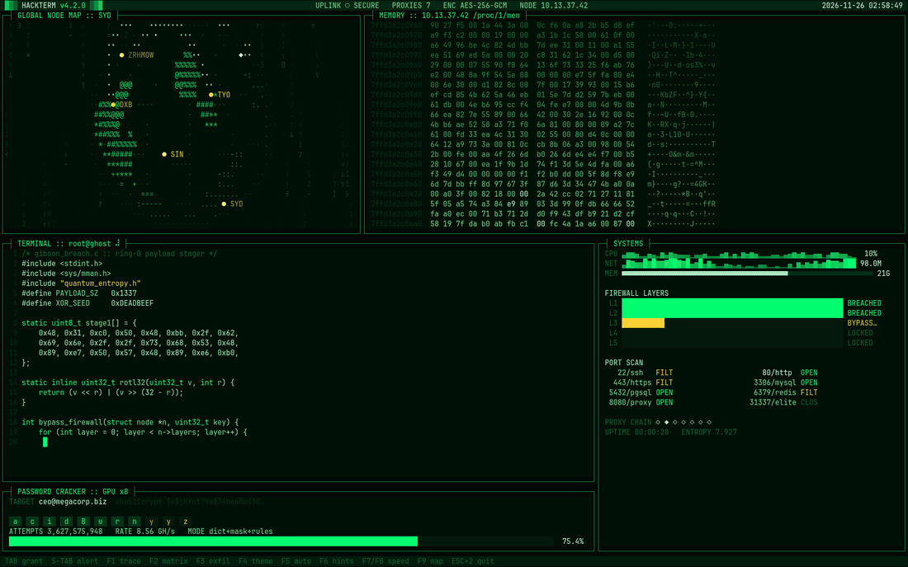
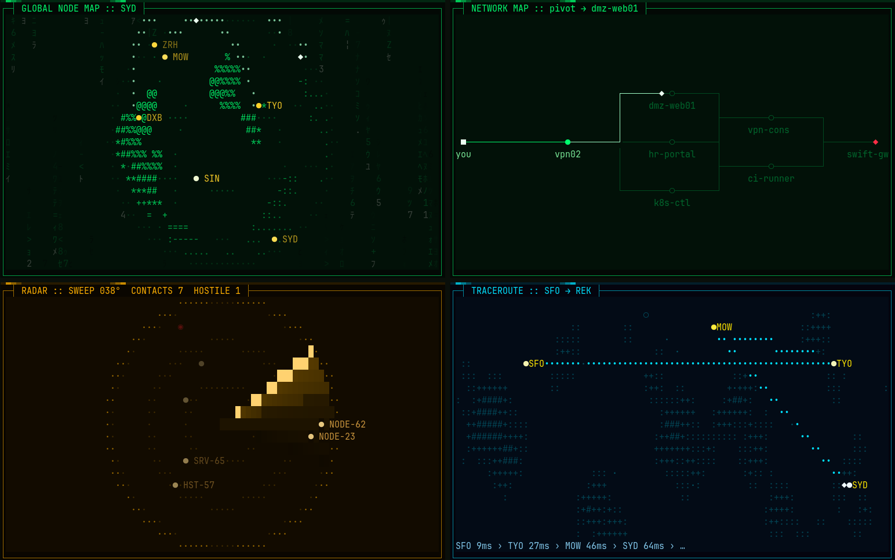

<div align="center">

# hackterm

**A cinematic fake-hacking console for your terminal.**
Mash the keyboard and look like you're breaching a mainframe, the way they do in the movies.

[](LICENSE)
[](https://www.python.org/)
[](#install)
[](#requirements)



</div>

hackterm is a Hollywood-style hacker screen, like [hackertyper](https://hackertyper.net) but in your real terminal and with a whole fake ops centre around it. A spinning globe, a leaking memory dump, a password cracker, firewall layers falling, alarms, trace-backs, matrix rain.

**It's pure theatre.** It makes no network connections, runs no commands and doesn't touch your system. It's one Python file with no dependencies.

Good for: pranking friends and coworkers, a screen in the background of a video or stream, a film or theatre prop, a party screensaver, or just feeling like a 90s movie hacker.

## Features

- **Type anything** and syntax-highlighted exploit code pours out (C, assembly, Python, shell). If you stop typing, it keeps going on its own.
- **Four swappable map panels** (`F9`):
  - a rotating ASCII **globe** with pulsing cities and connection arcs
  - a **network map** you pivot through host by host until the target falls
  - a **radar** sweep picking up contacts and hostiles
  - a world **traceroute** hopping city to city with latencies
- **Memory hex dump** that now and then "leaks" passwords, keys and secrets
- **Password cracker** that locks in characters one by one
- **Systems panel** with CPU and network sparklines, firewall layers being breached, a port scan and a proxy chain
- **Events:** ACCESS GRANTED, INTRUSION ALERT, a trace countdown with proxy rerouting, a fake download, fullscreen matrix rain
- **Boot sequence:** a fake kernel log, then a padlock over matrix rain that shakes and springs open as the uplink connects
- **Screen-tear glitches** like a video signal losing sync
- **Themes:** phosphor green, amber, cyber, red team, and your current [Omarchy](https://omarchy.org) theme if you use it
- **Calm by default, adjustable:** set the panel speed, how much each keypress types, and whether random events fire



## Install

You need Python 3.8+ and nothing else.

**One-liner** (installs to `~/.local/bin`):

```sh
curl -fsSL https://raw.githubusercontent.com/Farrooss/hackterm/main/hackterm.py -o ~/.local/bin/hackterm
chmod +x ~/.local/bin/hackterm
hackterm
```

**From a clone** (easy to update with `git pull`):

```sh
git clone https://github.com/Farrooss/hackterm.git
cd hackterm
ln -s "$PWD/hackterm.py" ~/.local/bin/hackterm
hackterm
```

Or skip installing and run `python3 hackterm.py`.

Make sure `~/.local/bin` is on your `PATH`.

## Controls

| Key | Effect |
|---|---|
| any key | type "code" (typing fast also speeds up the cracker and the hex dump) |
| `Tab` | ACCESS GRANTED |
| `Shift-Tab` | INTRUSION ALERT |
| `F1` | trace detected, then reroute through proxies |
| `F2` | fullscreen matrix rain |
| `F3` | fake download |
| `F4` | cycle theme |
| `F5` | turn random events on or off |
| `F6` | show or hide the key hints (they hide by themselves after 10s) |
| `F7` / `F8` | slow down / speed up the panels |
| `F9` | swap the map panel: globe, network map, radar, traceroute |
| `Esc Esc` / `Ctrl-C` | quit |

Tip: to pull off the prank, start it with `--no-boot`, press `F6` to hide the hints, and just type.

## Options

| Option | Effect |
|---|---|
| `--no-boot` | skip the boot sequence |
| `--version` | print the version and exit |
| `--theme N` | start on theme N (0 phosphor, 1 amber, 2 cyber, 3 red team, 4 Omarchy if you use it) |
| `--map N` | start on map N (0 globe, 1 network, 2 radar, 3 traceroute) |
| `--speed X` | panel speed from 0.25 to 2 (default 0.6) |
| `--chars N` | the most characters one keypress types (default 2) |

For example, `hackterm --no-boot --theme 1 --map 2 --speed 0.4` starts on an amber radar, running slowly.

## Requirements

- Linux (other Unix-likes with a POSIX terminal should work too, but aren't tested yet)
- Python 3.8 or newer, standard library only
- A truecolor terminal: Alacritty, Kitty, Ghostty, foot, WezTerm, GNOME Terminal, Konsole and others
- At least 60×20 characters; it looks best fullscreen

## Omarchy / Hyprland

For a fullscreen hotkey on [Omarchy](https://omarchy.org), add this to `~/.config/hypr/bindings.lua`:

```lua
o.bind("SUPER + SHIFT + CTRL + H", "Hackterm", { tui = "hackterm" })
```

and this to `~/.config/hypr/hyprland.lua`:

```lua
o.window("^org\\.omarchy\\.hackterm$", { fullscreen = true })
```

hackterm also picks up your current Omarchy theme's colours as an extra theme.

## FAQ

**Is this real hacking?** No. Everything on screen is made up: the code is a canned script, the IP addresses and hosts are fictional, and the "leaked" passwords are jokes. Nothing leaves your machine.

**Can it get me in trouble?** Only if you convince someone it's real. Please don't use it to scare people who might panic.

**It's too fast / too busy.** Press `F7` to slow the panels down, start with `--chars 1` for slower typing, or press `F5` to turn off the random popups.

## Contributing

Ideas, bug reports and pull requests are welcome. hackterm is a single file (`hackterm.py`) with no dependencies, and it should stay that way.

## License

[MIT](LICENSE)
